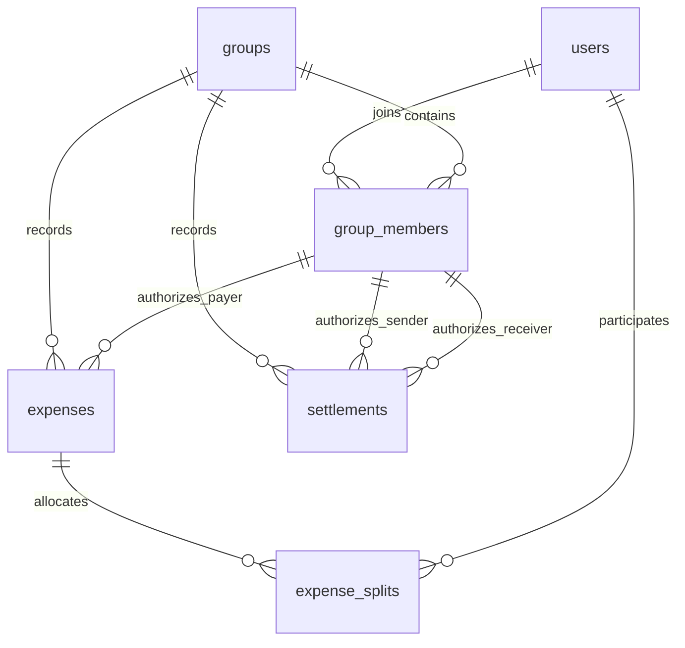

# Architecture and financial contract

Synchronous FastAPI handlers call transaction-owning services in a small modular monolith.
Pydantic validates HTTP inputs, SQLAlchemy 2/Psycopg use PostgreSQL, and explicit Alembic
migrations manage schema. No mutable balance cache, repository-per-model layer, background
worker, hosted dependency or external payment service is required.

## Schema and enforcement

| Table | Key | Purpose |
| --- | --- | --- |
| users | BIGINT identity | Stable ID; nonunique name |
| groups | BIGINT identity | Independent group identity |
| group_members | (group_id,user_id) | Unique add-only membership |
| expenses | BIGINT identity | Group, member payer, positive paise and description |
| expense_splits | (expense_id,user_id) | Immutable allocation snapshot, share >= 0 |
| settlements | BIGINT identity; UNIQUE(group_id,idempotency_key) | Immutable reported repayment |

Names are VARCHAR(100), descriptions VARCHAR(500), with database nonblank CHECKs. All
business columns are NOT NULL. Money and identifiers are BIGINT; timestamps are TIMESTAMPTZ
with PostgreSQL now() defaults. Every connection selects UTC. now() reflects transaction
start time; history ordering is created_at DESC,id DESC, not a promise of commit ordering.
All foreign keys use RESTRICT; no ORM cascade deletes financial history.

`0001_foundation` is unchanged. Forward revision `0002_settlements` adds one table with
positive amount, distinct sender/receiver and ASCII key CHECKs. Composite
(group_id,from_user_id)/(group_id,to_user_id) FKs reference group_members; its user FKs
transitively enforce existing users. A direct group FK makes group ownership explicit.
The named unique group/key constraint is final idempotency protection. History indexes are
(group_id,created_at DESC,id DESC); primary/unique indexes support membership and key lookup.
No duplicate standalone group/key index or speculative aggregation index is added.

Ordinary CHECK/FK constraints cannot enforce split sums, complete equal-split rosters,
repayment caps or immutability against privileged SQL. Cooperating application transactions
are authoritative writers. Direct SQL can edit valid-looking facts or explicitly delete
children/history in sequence. RESTRICT prevents destructive cascades, not arbitrary SQL
mutation. No update/delete financial route is exposed. Authentication is absent: trusted
demo only, with Compose ports bound to loopback.

## Expense amounts and immutable allocations

HTTP money is INR rupees; JSON decimal tokens are preserved as Decimal by DecimalRoute.
Conversion owns its Decimal context and rejects float/bool/nonfinite values, invalid syntax,
coefficients longer than 128 digits and fractional paise without rounding. Positive totals
and repayments support ₹0.01–₹1,000,000,000.00. Custom shares use the same conversion with
zero enabled. All internal financial arithmetic is integer paise. Exact rupee strings pair
with JSON integers; clients need lossless parsing beyond JavaScript's safe integer range.
Nonzero values below one paisa are rejected before scaling, including exponents that would
underflow Decimal arithmetic. Unrepresentable JSON exponents produce sanitized 422 errors.
Numerically exact trailing zeros are allowed (1.000); fractional paise (1.001) are rejected.

Omitted/null splits select equal mode: snapshot all locked current members, including payer;
integer divmod gives leftover paise to ascending IDs. Explicit custom splits must be nonempty,
unique current-member allocations whose nonnegative shares sum exactly to the total. Subsets
and payer exclusion are valid. Pure custom validation performs no SQL or redistribution.
The existing two-column split table needs no modification. New membership never rewrites
historical equal/custom shares. Equal roster completeness cannot be reconstructed from current
membership or transaction-start timestamps; readers therefore do not invent that guarantee.

## Transaction ownership and locking

Services own with session.begin() before first SQL and return only after successful commit.
The dependency opens/closes a session and never commits. Exceptions roll back; named expected
integrity conflicts are translated only after rollback. Pool pre-ping, hidden SQL parameters,
UTC connection settings and sanitized domain/SQLAlchemy error handlers remain in use.

All expense, membership and repayment writes use READ COMMITTED and lock the group row as
**the first query**. Financial/membership reads happen in subsequent statements after lock
acquisition, seeing any writer that committed while the lock waited. Cooperating group
writers cannot change these facts until the owner commits. Independent groups can progress.
No pre-lock GET suggestion or stale repeatable-read snapshot authorizes a repayment.

Expense writes validate members/payer and allocations, insert parent and all splits, flush,
validate response and commit once. Failed child insertion rolls back the parent. Repayments
validate replay first, then user existence, membership, distinctness, current signs and caps,
insert one historical fact, validate output and commit. Sender must be negative, receiver
positive, amount <= both outstanding magnitudes. Reported payments do not call banks.

Idempotency-Key is mandatory ASCII [A-Za-z0-9._:-], 1–128 characters, group-scoped and
case-sensitive. Canonical equality means sender ID, receiver ID and exact paise, not raw decimal
spelling. Same request/key replays original ID/timestamp/amount with 200; new rows return 201;
changed canonical request returns 409. Replay precedes now-zero balance validation. Separate
keys permit legitimate equal partial repayments. Concurrent retries serialize on the group;
a named unique conflict from a bypassing writer retries lookup under a fresh locked transaction,
after rollback. No in-memory replay cache is used. Restart behavior is tested.
Ordinary expense POSTs have no idempotency key: concurrent repeats or retries may create
separate complete expenses. Atomicity does not provide duplicate-request prevention.

## One derived outstanding ledger

`NET = expense_paid - allocated_share + settlements_sent - settlements_received`.

Positive means receive; negative means owe. Spending fields remain expense-only; repayment
contributions have separate member totals. Each payment credits sender and debits receiver
exactly. Per-expense sums, group spending conservation, repayment sent/received conservation
and each member's incoming-minus-outgoing derived debt are checked exactly.

The public balance service owns one REPEATABLE READ / READ ONLY transaction configured
before its first query. The reusable calculate_in_transaction helper owns no transaction:
read callers supply that snapshot; repayment writers supply their held group lock under
READ COMMITTED. No second competing aggregation implementation or nested read-only write
transaction exists.

Read statements:

1. Group existence.
2. Per-expense outer-joined sum/member integrity check, detecting missing splits and outsiders.
   Payer presence is not required because custom splits may exclude payer.
3. UNION ALL contributions for paid/share/sent/received, aggregated by user and outer joined
   to current members/names, including inactive members. Each event enters once per relevant
   contribution; no one-to-many multiplication. SUM(BIGINT) is exact NUMERIC → Python int.
4. Expense-only groups aggregate nonpayer participant→payer obligations and cancel reverse pairs.

After any repayment the fourth query is unnecessary. `debt_basis=net_after_repayments` labels
`debts` as an ID-ordered canonical plan derived from current nets; it does not claim original
expense-pair provenance. Expense-only groups retain expense_pairwise and their original
pairwise semantics, including cycles. The strategy intentionally chooses simpler net-based
normalization instead of a bespoke directed-cycle cancellation engine. When all nets zero,
no actionable edge remains even after optimized payments that would otherwise leave cycles.
Historical expenses/splits/repayments remain unchanged and independently inspectable.

Successful balance/preview reads execute four statements for expense-only groups and three
for repaid groups, independent of history size; names need no per-transfer lookup. History
listing has existence plus one joined query. Read settings reset on pool return. Events,
independent PIDs and observed pg_blocking_pids waits establish concurrency tests without
assuming races from arbitrary sleeps. The guarantee is per response, not across separate GETs.

## Product Enhancement — Smart Settlement Suggestions

The product goal remains actionable, understandable payment instructions. Pure greedy matching
sorts current debtors/creditors by ID, transfers min(outstanding magnitudes), advances exhausted
positions and independently replays the full plan. For N nonzero members at most N−1 transfers
are produced. The Phase 4 selector validates pairwise and greedy candidates and compares
(count,total routed paise,canonical sequence). Identical plans report netted_greedy. Original
pairwise fallback remains when its proposed routes satisfy current debtor/creditor signs.

Phase 5 identified a concrete issue: pairwise obligations can route through an intermediary
whose current net does not allow that payment. If the selected plan is not debtor→creditor,
component_netting instead nets each weakly connected zero-sum component, then compares that
candidate with global greedy. For a component with V vertices and E edges, E>=V−1; its greedy
plan uses at most Ncomponent−1<=V−1 transfers. Thus this debtor-to-creditor candidate cannot
exceed the pairwise count; choosing against global greedy also preserves the N−1 bound.
Each candidate passes independent replay. Traversal order does not affect final sorted output.

Concrete case: nets [+4,+5,+6,−10,−5], original edges 4→3 10,3→1 4,5→2 5. Pairwise uses
3 transfers versus global greedy's 4, but 4→3 exceeds receiver 3's credit. Component netting
returns 4→1 4,4→3 6,5→2 5: 3 transfers that satisfy repayment caps. Public API tests record
all of them successfully. A deterministic 200-example property verifies direct signs,
reconciliation, order invariance and both count bounds.

Counts describe aggregated routes, not settlement POST requests. Two maximum expenses can
produce one 200000000000-paise route, above the 100000000000-paise per-report cap. Report
it as two bounded partial amounts with distinct keys; re-fetch after intervening ledger
changes. Splitting routes in the preview would invalidate its route-count guarantees, so
the exact aggregate remains visible. This is an explicit API limit, not a payment-provider
instruction or a guarantee that each route fits one POST.

After recorded repayments the labelled canonical outstanding plan is the baseline; the
compatibility field pairwise_transfer_count counts that current baseline. Preview responses
include debt_basis, suggestions_recorded=false and has_recorded_settlements. Deprecated
payments_recorded=false means this GET made no payment write, not that history is empty.
Suggestions are not recorded repayments and do not modify balances. Payment volume is not
money saved. Stale previews must be revalidated on POST; no payment-provider verification exists.

Matching is O(M+N log N), validation O(M+P+N), pairwise sorting O(P log P), extra component
traversal O(M+P) plus sorting, with O(M+P) memory. These costs exclude PostgreSQL work over
expense/split/repayment histories. No dense matrix, cache or per-transfer database query exists.
The heuristic is not globally minimal: nets [+5,+4,−4,−5] with pairwise equal to three-edge
greedy still use three, while 3→2 4 and 4→1 5 use two. This certificate and the real equal-split
fallback remain tested. README retains product motivation and the Hotel/Taxi three-to-two example.

## Migration and operational limits

Compose waits for database TCP health, runs one forward migration job and starts the non-root
API after success. Fresh and populated 0001 databases upgrade to 0002 on both PostgreSQL
versions. Disposable tests verify 0002→0001→0002 preservation of expense allocations and full
base round trips. Never downgrade important repayment data: 0002 downgrade drops those facts,
changing derived outstanding balances even while preserving expenses.

No destructive live migration test or global Docker change is used. Dependencies stay pinned;
configuration remains environment-driven. Lists are unpaginated and long repeatable-read
snapshots can retain old row versions. No production-scale throughput or index speedup claim
is made. Direct SQL, user-reported payment honesty, authentication, idempotency retention
(unbounded in this assignment), payment reversals and member-removal lifecycle remain explicit
trust/product limitations. No Phase 6 feature is included.
